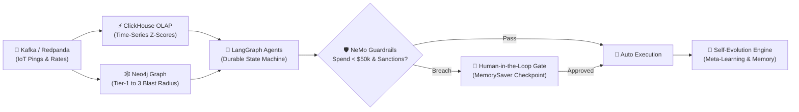

# 🏆 Hackathon Pitch Deck: Self-Evolving AI Supply Chain Network
**Theme**: Autonomous Enterprise AI & Resilient Global Infrastructure  
**Target Duration**: 3 to 5 Minutes (with Live Demo)

---

## 📽️ Slide 1: The Hook — The $50B Fragility Crisis

### Headline:
> **"When a ship stops in the Red Sea, why does a car factory in Detroit halt three weeks later?"**

### Bullet Points:
* **The Reality**: Global supply chains handle $24 Trillion in trade annually, yet are managed via static ERP spreadsheets and reactive phone calls.
* **The Bottleneck**: Maritime chokepoints (Suez, Panama, Malacca) and single-source component failures cause unpredictable lead time spikes (+300%) and emergency spot rate surges.
* **Our Mission**: Build an **Autonomous, Self-Evolving Multi-Agent Network** that monitors the world in real time, predicts market shifts, traverses supplier blast radiuses, and dynamically renegotiates contracts within safe operational boundaries.

---

## 📽️ Slide 2: The Problem — The Tier-N Blindspot & LLM Risk

### Headline:
> **"OEMs only see Tier 1. And pure LLMs can hallucinate multi-million dollar contracts."**

### Key Insights:
1. **The Tier-N Blindspot**:
   * An OEM (e.g. Apex Global) knows their Tier-1 ECU supplier (Alpha PowerSystems in Germany).
   * But they *don't* know that Tier-1 depends on a Tier-2 microcontroller in Taiwan, which depends on a Tier-3 lithium refiner in Chile.
   * If Tier 3 fails, the OEM is blind to the catastrophe until factory lines halt.
2. **The LLM Hallucination & Spend Risk**:
   * Raw AI agents cannot be given direct access to corporate bank accounts or procurement contracts.
   * Without deterministic guardrails, an LLM can book an unverified supplier, violate international sanctions, or pay a 200% premium.

---

## 📽️ Slide 3: The Architecture — 5-Pillar Enterprise Engine

### Headline:
> **"Sub-second streaming, dual OLAP/Graph storage, durable LangGraph state, and NeMo Guardrails."**

### The Tech Stack:
* **Streaming**: Kafka / Redpanda handles high-throughput telemetry pings.
* **Time-Series OLAP**: ClickHouse computes rolling variance and z-scores for rate surge detection.
* **Knowledge Graph**: Neo4j maps the full graph topology and computes blast radiuses down to raw materials.
* **Orchestration**: LangGraph StateGraph ensures **durable execution** with checkpoint resumption.
* **Safety**: NeMo Guardrails enforces spending limits, trade sanctions, and triggers **Human-in-the-Loop**.

---

## 📽️ Slide 4: Live Demonstration & Disruption Scenario

### Headline:
> **"From Geopolitical Shock to Autonomous Mitigation in 2.8 Seconds."**

### Demonstration Flow (Shown on Screen):
1. **Live Feed**: Kafka streams container telemetry into the terminal window.
2. **The Disruption**: Trigger *"Simulate Red Sea Blockade"*.
   * ClickHouse flags a **+75% freight rate spike** on the Suez corridor.
   * Neo4j traverses the dependency tree: identifies **4 impacted entities** and **$14.7M in jeopardized OEM contracts**.
   * Contract Negotiator synthesizes a bypass contract with *Saigon Advanced Assembly* (saving 12 days).
3. **Guardrail Protection**:
   * If the contract value exceeds the **$50,000 threshold**, LangGraph **halts execution** at the Human-in-the-Loop breakpoint.
   * Supervisor clicks `✅ Authorize Renegotiation` in the dashboard.
4. **Self-Evolution in Action**:
   * System calculates post-resolution reward ($+68.8$).
   * Advances from **Generation 1 $\rightarrow$ Generation 2**, self-tuning its heuristic weights and writing lessons learned to episodic memory.

---

## 📽️ Slide 5: Business Impact & Why We Win

### Headline:
> **"Measurable ROI, Enterprise Safety, and True Continuous Learning."**

### 1. Financial Impact:
* **Millions in Downtime Avoided**: Proactive rerouting saves $8,500/day per delayed container.
* **Zero Autonomous Overspend**: Hard mathematical guardrail prevents rogue transactions.

### 2. Competitive Differentiators:
| Feature | Traditional ERP | Simple LLM Chatbots | Our Self-Evolving Network |
| :--- | :--- | :--- | :--- |
| **Real-Time Streaming** | ❌ Weekly batch | ❌ Static prompt | ✅ Kafka sub-millisecond |
| **Tier-N Visibility** | ❌ Tier-1 only | ❌ Hallucinated | ✅ Neo4j multi-tier graph |
| **Execution Safety** | ✅ Manual | ❌ Unbounded spend | ✅ NeMo Guardrails + HITL |
| **Continuous Learning**| ❌ Static rules | ❌ Memory loss | ✅ Meta-learning evolution |

### 3. Immediate Future Roadmap:
* Multi-modal routing integration (Air freight spot dispatch & rail corridors).
* Sovereign regional pipelines (EU GDPR & US ITAR compliant sovereign sub-graphs).
* Integration with enterprise ERPs (SAP S/4HANA & Oracle SCM).

---

### 🎤 Speaker Tips for Presenters:
1. **Start with energy**: Don't begin with "Hi, our project is called X". Start with Slide 1's hook.
2. **Keep the demo moving**: Trigger the simulation, show the red banner, click approve, and highlight the generation bump.
3. **Emphasize Safety**: Judges love to ask about safety—preempt them by showing the **NeMo Guardrails sliders** right on the dashboard!
