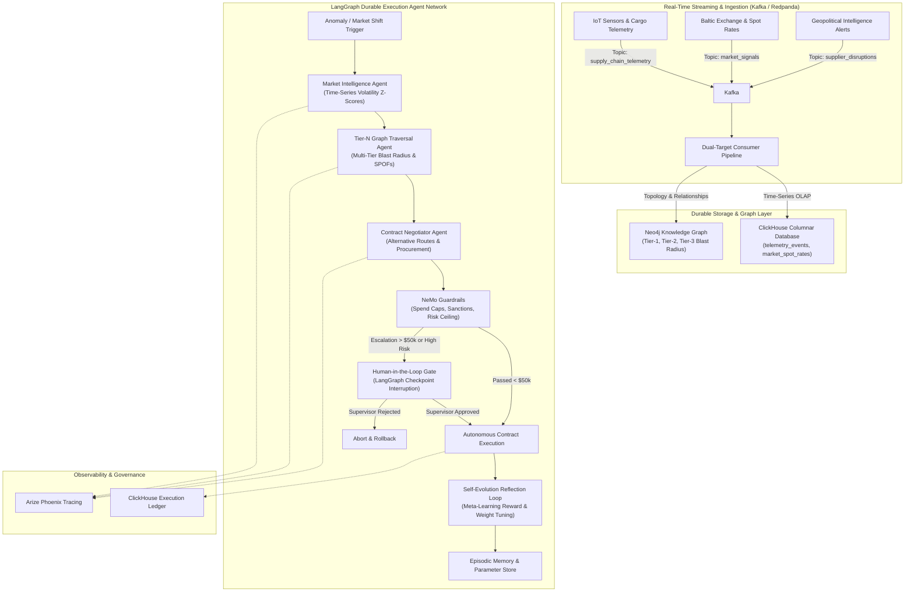

# 🌐 Autonomous Self-Evolving AI Supply Chain Network

An enterprise-grade, agentic orchestration architecture designed to manage complex global supply chains in real time, forecast macro market shifts, traverse multi-tier (Tier-N) supplier dependencies, enforce operational and financial guardrails, and autonomously self-evolve through meta-learning reflection loops.

---

## 🏛️ System Architecture Overview



---

## 🛠️ Technology Stack Breakdown

| Domain | Technology | Enterprise Role & Functionality |
| :--- | :--- | :--- |
| **Agent Orchestration** | **LangGraph** (StateGraph) | Durable execution, checkpointing (`MemorySaver`), and interruption gates for Human-in-the-Loop on high-risk contracts. |
| **Event Streaming** | **Apache Kafka / Redpanda** | Sub-millisecond pub/sub streaming of IoT vessel telemetry, port congestion indices, and spot freight prices. |
| **Time-Series Analytics** | **ClickHouse** | Columnar OLAP engine for rolling z-score volatility detection, rate surge analysis, and immutable agent execution auditing. |
| **Dependency Graph** | **Neo4j** | Multi-tier knowledge graph (OEM -> Tier 1 -> Tier 2 -> Tier 3), single point of failure (SPOF) traversal, and blast radius calculation. |
| **Policy Guardrails** | **NeMo Guardrails** | Deterministic spending limits ($50,000 threshold), rate markup ceiling (15%), sanctions embargo checks, and single-source protection. |
| **Observability** | **Arize Phoenix** / OpenTelemetry | Full distributed tracing of agent reasoning chains, tool execution latencies, token consumption, and decisions. |
| **Command Center UI** | **FastAPI & HTML5 Canvas** | Cyber-command executive interface with real-time graph rendering, streaming logs, and supervisor approval controls. |

---

## 📂 Project Directory Structure

```text
d:\Evolving_AI\
├── docker-compose.yml              # Multi-container stack (Kafka/Redpanda, ClickHouse, Neo4j, Phoenix)
├── docker/
│   ├── clickhouse/
│   │   └── init.sql                # ClickHouse schema: MergeTree tables & materialized views
│   └── neo4j/
│       └── init_graph.cypher       # Neo4j Cypher seed script: Multi-tier supply chain topology
├── ingestion/
│   ├── producer_stream.py          # Kafka event producer generating IoT telemetry and market shifts
│   ├── consumer_pipeline.py        # Dual-route consumer streaming data to ClickHouse and Neo4j
│   └── mock_event_bus.py           # High-speed in-memory streaming bus for zero-dependency local runs
├── storage/
│   ├── clickhouse_client.py        # ClickHouse client with fast socket probing and embedded fallback
│   └── neo4j_client.py             # Neo4j Cypher client with blast-radius calculation
├── agents/
│   ├── state.py                    # LangGraph State channels schema (TypedDict)
│   ├── market_intelligence_agent.py# ClickHouse time-series volatility and rate anomaly analyzer
│   ├── graph_traversal_agent.py    # Neo4j multi-tier graph dependency and blast radius calculator
│   ├── contract_negotiator_agent.py# Dynamic mitigation and backup procurement negotiator
│   ├── hitl_checkpoint.py          # NeMo Guardrails validator and HITL interruption breakpoint
│   ├── self_evolution_agent.py     # Meta-learning reflection engine and adaptive weight tuner
│   └── workflow.py                 # Compiled LangGraph StateGraph with durable checkpointer
├── guardrails/
│   ├── operational_limits.py       # Deterministic spend limits, sanctions check, and token budgets
│   └── nemo_config.yml             # Colang 2.0 policy configuration
├── observability/
│   └── tracer.py                   # Arize Phoenix & OpenTelemetry tracing provider
├── web/
│   ├── server.py                   # FastAPI application serving REST APIs and static dashboard
│   └── static/
│       ├── index.html              # Cyber-command mission control dashboard
│       ├── app.js                  # Interactive Canvas graph physics and real-time polling
│       └── style.css               # Premium dark glassmorphic design system
├── run_demo.py                     # One-click end-to-end runnable demonstration script
└── README.md                       # Architecture blueprint and operational manual
```

---

## ⚡ How the Self-Evolution Loop Operates

The agent network does not remain static; it utilizes a continuous meta-learning feedback cycle:

1. **Objective Reward Function**:
   $$\text{Reward} = (0.6 \times \Delta\text{Risk}) + (3.5 \times \Delta\text{Days Saved}) - \text{Penalty}_{\text{Cost Overrun}}$$
2. **Adaptive Parameter Tuning**:
   - `supplier_reliability_weight`: Incrementally weighted whenever disruptions occur.
   - `adaptive_risk_threshold`: Dynamically calibrated based on human supervisor validation trends.
   - `transit_speed_weight`: Adjusted dynamically during maritime corridor bottlenecks.
3. **Episodic Reflection & Prompt Memory**:
   - Every completed mitigation writes a structured insight into `evolution_memory.json`.
   - In subsequent execution cycles, the agents query episodic memory to avoid repeating historical bottlenecks.

---

## 🚀 Quickstart Guide

### Local Development

#### 1. Launch Multi-Container Infrastructure (Optional)
If Docker Desktop is installed and running:
```bash
docker-compose up -d
```
This spins up:
- **Redpanda Console**: `http://localhost:8080`
- **ClickHouse HTTP**: `http://localhost:8123`
- **Neo4j Browser**: `http://localhost:7474` (User: `neo4j`, Password: `SupplyChainPass2026!`)
- **Arize Phoenix**: `http://localhost:6006`

> **Note on Standalone Resilience**: If Docker is not active, the system automatically and instantaneously initializes its embedded in-memory time-series and graph engines. Zero configuration is needed to run immediately!

#### 2. Run the End-to-End Orchestration Demo
Run the CLI demo script to see Kafka ingestion, ClickHouse rate spike detection, Neo4j blast radius traversal, LangGraph checkpointing, and self-evolution in action:
```bash
python run_demo.py
```

#### 3. Launch the Mission Control Web Dashboard
```bash
python -m uvicorn web.server:app --host 127.0.0.1 --port 8000
```
Open your browser to:
👉 **`http://127.0.0.1:8000`**

- **Interactive Canvas Graph**: Drag nodes, inspect Tier 1/2/3 entities, and visualize glowing blast radius corridors.
- **Simulate Red Sea Blockade**: Fires a critical maritime disruption event, halts at the Human-in-the-Loop breakpoint, and allows human authorization.
- **Stream IoT Data**: Pushes real-time container GPS coordinates and spot rate updates.
- **Evolution Monitor**: Watch the self-evolution generation advance and inspect self-tuned weights.

---

## ☁️ Cloud Deployment (Render / Railway)

The system supports cloud deployment on Render and Railway with automatic backend adaptation:

### Architecture Adaptation for Cloud

| Component | Local (Docker) | Cloud (Render/Railway) |
|-----------|----------------|----------------------|
| **Time-Series Database** | ClickHouse | PostgreSQL + TimescaleDB |
| **Knowledge Graph** | Neo4j | PostgreSQL (adjacency list pattern) |
| **Event Streaming** | Kafka/Redpanda | Redis Pub/Sub |
| **Storage** | Local volumes | Managed cloud databases |

### Deployment to Render

1. **Push your code to GitHub**

2. **Create a new Render account** at [render.com](https://render.com)

3. **Deploy using render.yaml**:
   - Connect your GitHub repository
   - Render will automatically detect `render.yaml`
   - It will create:
     - PostgreSQL database with TimescaleDB
     - Redis instance for event streaming
     - FastAPI web service
     - Background worker for agent execution

4. **Set environment variables** in Render dashboard:
   ```bash
   DATABASE_URL=postgresql://...
   REDIS_URL=redis://...
   MAX_AUTONOMOUS_CONTRACT_USD=50000.0
   MAX_PERMITTED_PRICE_PREMIUM_PCT=15.0
   RISK_HITL_THRESHOLD=65.0
   SANCTIONED_COUNTRIES=RU,KP,IR,SY
   ```

5. **Enable TimescaleDB extension** (via PostgreSQL shell in Render):
   ```sql
   CREATE EXTENSION IF NOT EXISTS timescaledb;
   ```

### Deployment to Railway

1. **Push your code to GitHub**

2. **Create a new Railway project** at [railway.app](https://railway.app)

3. **Import repository** - Railway will detect `railway.json`

4. **Add services**:
   - PostgreSQL database (enable TimescaleDB extension)
   - Redis instance
   - Python web service
   - Python worker service

5. **Set environment variables** in Railway dashboard (same as Render above)

### Cloud-Specific Files

- `render.yaml` - Render deployment configuration
- `railway.json` - Railway deployment configuration
- `storage/cloud_postgres_client.py` - PostgreSQL + TimescaleDB client
- `storage/cloud_graph_client.py` - PostgreSQL graph client
- `ingestion/redis_stream_client.py` - Redis event streaming
- `.env.cloud.example` - Cloud environment variable template

### Automatic Backend Selection

The system automatically detects cloud deployment via `DATABASE_URL` or `REDIS_URL` environment variables and switches to cloud backends:

```python
# In config.py
is_cloud_deployment: bool = bool(os.getenv("DATABASE_URL") or os.getenv("REDIS_URL"))

# In storage/__init__.py
if settings.is_cloud_deployment:
    time_series_client = cloud_postgres_client  # PostgreSQL
    graph_client = cloud_graph_client  # PostgreSQL graph
else:
    time_series_client = clickhouse_client  # ClickHouse
    graph_client = neo4j_client  # Neo4j
```
